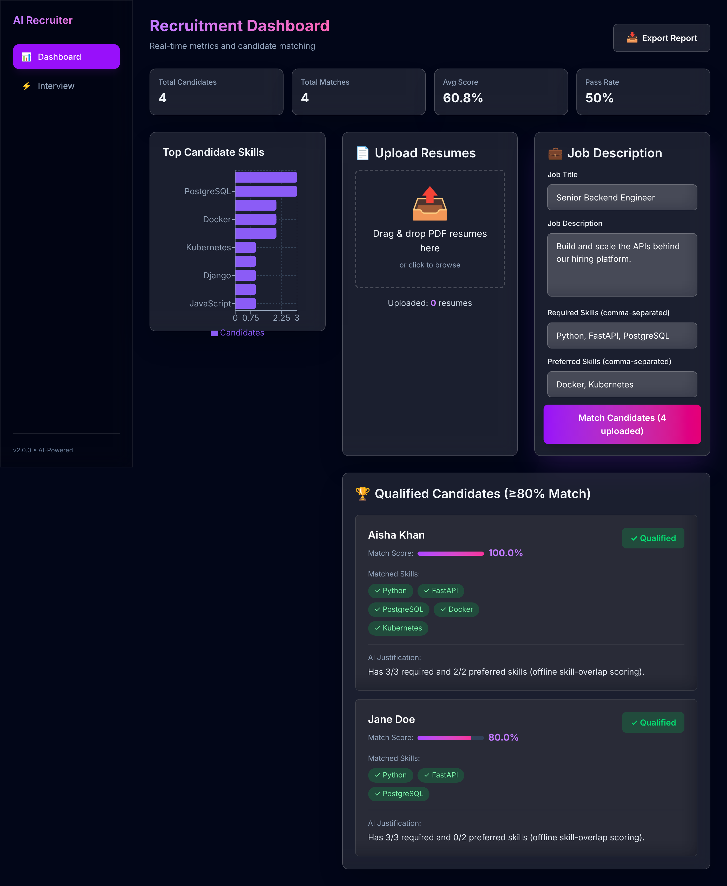
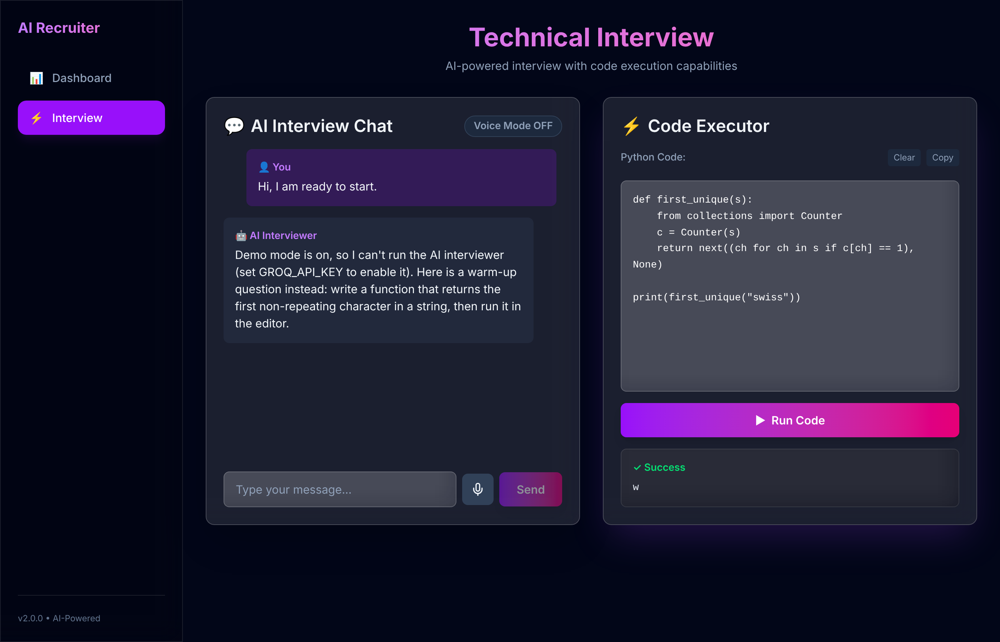
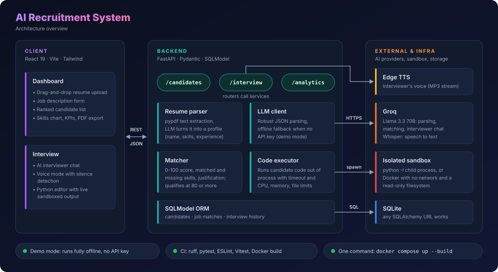

<div align="center">

# 🤖 AI Recruitment System

**Screen resumes, rank candidates and run AI-led technical interviews with live code execution, in one app.**

[](https://github.com/yunus5603/AI-Recruitment-System/actions/workflows/ci.yml)
[](LICENSE)


[](CONTRIBUTING.md)



</div>

## Why this exists

Screening resumes and running first-round technical interviews eats hours of
an engineering team's week. This project automates the repetitive parts:

1. **Parse** PDF resumes into structured profiles (contact, skills, experience, education).
2. **Match** every candidate against a job description and keep only those scoring **80% or more**.
3. **Interview** shortlisted candidates with an AI interviewer that can see their code, by text or voice.
4. **Run** the candidate's Python in a **sandbox** and show the output live.
5. **Report** on the pipeline with a dashboard and a one-click PDF export.

## Quick start

No API key needed: without `GROQ_API_KEY` the app runs in **demo mode**, with
offline resume parsing and deterministic skill-overlap scoring.

```bash
git clone https://github.com/yunus5603/AI-Recruitment-System.git
cd AI-Recruitment-System
docker compose up --build
```

Open the UI at <http://localhost:5173> and the API docs at <http://localhost:8000/docs>.
To use the real LLM, copy `backend/.env.example` to `backend/.env`, add a free
[Groq API key](https://console.groq.com/keys) and restart.

Need a resume to try? `python backend/scripts/create_sample_resume.py` writes one.

<details>
<summary>Run without Docker</summary>

```bash
# Backend (Python 3.11+)
cd backend
python -m venv .venv && source .venv/bin/activate
pip install -r requirements.txt
cp .env.example .env            # optional: add GROQ_API_KEY
uvicorn main:app --reload

# Frontend (Node 20+), in a second terminal
cd frontend
npm ci
npm run dev
```
</details>

## Features

| | |
|---|---|
| 📄 **Resume parsing** | PDF text extraction with `pypdf`, structured by Llama 3.3 70B into JSON |
| 🎯 **Candidate ranking** | LLM scoring with matched/missing skills and a written justification |
| 💬 **AI interviewer** | Context-aware chat that reads the code in the candidate's editor |
| 🎙️ **Voice mode** | Whisper transcription, Edge TTS replies, automatic silence detection |
| ⚡ **Sandboxed code runner** | Isolated process with time, memory, file and process limits ([threat model](SECURITY.md)) |
| 📊 **Analytics** | Pass rate, average score, top skills chart, PDF report export |
| 🧪 **Demo mode** | Runs fully offline without an API key, for local dev, CI and hosted demos |



## Architecture

<p align="center">
  
</p>

### How matching works

1. The job description (title, description, required and preferred skills) and
   the candidate's parsed profile go into a structured prompt.
2. Llama 3.3 70B returns JSON with a score from 0 to 100, matched and missing
   skills, and a justification. Temperature is kept low (0.3) for consistency.
3. The reply is parsed defensively: Markdown fences and chatty wrappers are
   stripped, and the score is clamped to 0 to 100, so a malformed reply becomes
   a clear error instead of a crash.
4. Every score is saved for analytics; only candidates at **80 or above** are
   returned, highest first.

In demo mode, step 2 is replaced by a transparent formula: required skills are
worth 80 points and preferred skills 20, so a candidate with every required
skill exactly reaches the threshold.

### Security: running untrusted code

Candidates run arbitrary Python, which is remote code execution by design. The
code never runs inside the API process: it runs in a separate interpreter with a
scrubbed environment, an empty working directory, a wall-clock timeout and
`rlimit`s on CPU, memory, file size, open files and processes. For public
deployments, `CODE_EXECUTOR=docker` runs each snippet in a throwaway container
with no network and a read-only filesystem. Each control has a test that tries
to break it. See [SECURITY.md](SECURITY.md) for the full threat model.

## API

Interactive docs are served at `/docs` (Swagger) and `/redoc`.

| Method | Endpoint | Description |
|---|---|---|
| `POST` | `/candidates/upload-resume` | Upload a PDF, returns the parsed profile |
| `POST` | `/candidates/match` | Score all candidates against a job, returns qualified ones |
| `GET` | `/candidates/all` | List stored candidates |
| `DELETE` | `/candidates/clear` | Delete candidates and match history |
| `POST` | `/interview/chat` | Send a message to the AI interviewer |
| `POST` | `/interview/execute-code` | Run Python in the sandbox |
| `GET` | `/interview/history` | Chat history |
| `DELETE` | `/interview/clear-history` | Clear chat history |
| `POST` | `/interview/transcribe` | Speech to text (Whisper) |
| `POST` | `/interview/speak` | Text to speech (MP3 stream) |
| `GET` | `/analytics/dashboard` | Totals, average score, pass rate |
| `GET` | `/analytics/skills` | Top 10 skills across candidates |
| `GET` | `/analytics/export` | PDF report |
| `GET` | `/health` | Health check, reports whether demo mode is on |

## Testing

```bash
cd backend && pytest          # 41 tests: parser, matcher, routers, sandbox escapes
cd frontend && npm test       # Vitest + Testing Library
```

The backend suite never calls Groq: a fake client scripts the model's replies,
including malformed ones. CI runs ruff, pytest, ESLint, Vitest, the production
build and the Docker images on every push and pull request.

## Configuration

All settings are environment variables; see [`backend/.env.example`](backend/.env.example).

| Variable | Default | Purpose |
|---|---|---|
| `GROQ_API_KEY` | _(unset: demo mode)_ | Enables the LLM features |
| `DATABASE_URL` | `sqlite:///recruitment.db` | Any SQLAlchemy URL |
| `CORS_ORIGINS` | `http://localhost:5173,http://localhost:3000` | Allowed frontend origins |
| `CODE_EXECUTOR` | `subprocess` | `docker` for container isolation |
| `CODE_TIMEOUT_SECONDS` / `CODE_MEMORY_MB` | `5` / `256` | Sandbox limits |
| `VITE_API_URL` (frontend) | `http://localhost:8000` | Backend URL baked into the build |

## Project structure

```
backend/
  main.py                FastAPI app, CORS, routers
  routers/               candidates, interview, analytics
  services/
    llm.py               lazy Groq client, demo mode, robust JSON parsing
    resume_parser.py     PDF -> structured profile
    matcher.py           LLM scoring + offline skill-overlap fallback
    code_executor.py     sandboxed Python runner
  models/                SQLModel tables, Pydantic schemas
  tests/                 pytest suite
frontend/src/
  pages/                 Dashboard, Interview
  components/            upload, job form, candidate list, chat, charts
  hooks/useAudioRecorder.js
  lib/api.js             backend URL
```

## Roadmap

- [ ] Authentication and per-recruiter workspaces
- [ ] PostgreSQL and Alembic migrations
- [ ] DOCX resume support
- [ ] Streamed interviewer replies
- [ ] Per-user rate limiting on code execution and gVisor isolation
- [ ] Interview scorecards and a final candidate report
- [ ] Hosted demo running in demo mode
- [ ] More languages in the code runner (JavaScript, Java)

## Contributing

Contributions are welcome. Start with [CONTRIBUTING.md](CONTRIBUTING.md), and
look for issues labelled `good first issue`. No API key is needed to develop.

## License

[MIT](LICENSE)
